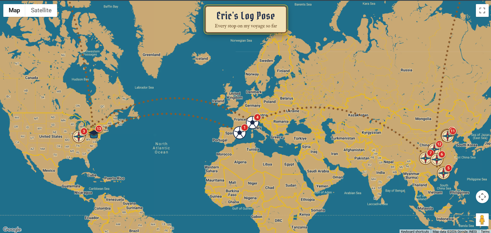
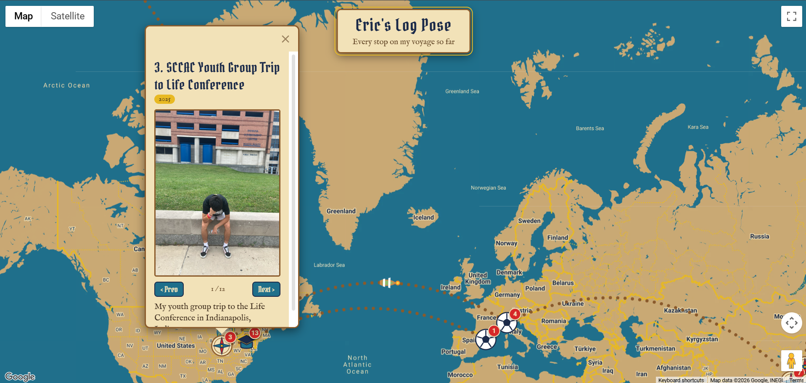

# DevProjects - Build a custom google maps theme

# Eric's Log Pose: A One Piece Themed Memory Map

A custom-themed Google Map that charts the places from my life so far, styled like a pirate's treasure map from One Piece. Each stop has a photo gallery and description, and a Thousand Sunny-style ship sails along a dotted route connecting the stops in order.

This is an open source project from [DevProjects](http://www.codementor.io/projects).
Project requirements: [Build a custom google maps theme](https://www.codementor.io/projects/web/build-a-custom-google-maps-theme-bf8levr6eg)

## Features

- Custom map style: parchment land, deep ocean blue, and gold borders
- Custom SVG marker icons for each category (soccer, school, travel)
- Numbered stops that follow the order of the journey
- Info windows themed to match the map, with a photo gallery and Prev/Next buttons
- Dotted route with an animated ship sailing between stops
- Title banner and a login screen styled to match the theme
- Responsive layout that works on phones

## Tech/framework used

Built with:

- HTML, CSS, and vanilla JavaScript
- [Google Maps JavaScript API](https://developers.google.com/maps/documentation/javascript)
- [Google Fonts](https://fonts.google.com/) (Pirata One and IM Fell English)
- Hosted on GitHub Pages

## Screenshots and demo

Live demo: https://ericwho6.github.io/Custom-Google-Maps-Theme/




## Installation

1. Clone the repository:
   ```bash
   git clone https://github.com/ericwho6/Custom-Google-Maps-Theme.git
   cd Custom-Google-Maps-Theme
   ```

2. Get a Google Maps API key:
   - Create a project in the [Google Cloud Console](https://console.cloud.google.com) and enable billing (Maps has a free monthly allowance).
   - Enable the **Maps JavaScript API**.
   - Create an API key and restrict it to the Maps JavaScript API and to your site's addresses (for example `http://localhost:5500/*`).

3. Add your key in `login.js`, in the `loadMaps` function, in place of the existing key.

4. Set your own login:
   - Open the page and run this in the browser console, using your own username and password:
     ```javascript
     sha256("yourusername:yourpassword").then(console.log)
     ```
   - Paste the result into `VALID_HASH` at the top of `login.js`.

5. Add your own photos to an `images/` folder, and edit the `memories` array in `app.js` with your locations, descriptions, and photo paths.

6. Run it with a local server, such as the VS Code **Live Server** extension, since opening the file directly can break the API key restrictions.

## Notes

The login screen is a simple front-end gate, so it keeps casual visitors out but is not real security. Anyone who views the page source can find the image files. Don't use it to protect anything truly private.

## License

[MIT](https://choosealicense.com/licenses/mit/)
